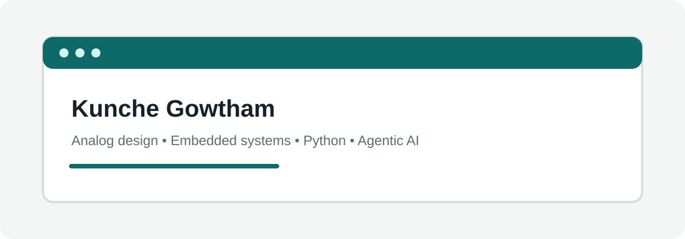

# Kunche Gowtham — Portfolio

Personal portfolio for Kunche Gowtham, an Electronics and Communication Engineering graduate building across analog and mixed-signal design, embedded systems, Python, and agentic AI.

## Focus areas

- Analog and mixed-signal circuit design
- Embedded systems and Arduino projects
- Python and Flask applications
- Agentic AI with LangChain, the OpenAI Agents SDK, and MCP

## Selected work

- [Bandgap Voltage Reference](https://github.com/kuncheGowtham/Design-of-a-Bandgap-Voltage-Reference-Circuit) — temperature-compensated analog IC design
- [FuelTopUp](https://github.com/kuncheGowtham/FuelTopUp) — location-based fuel delivery platform built with Flask
- [Electronic Dice](https://github.com/kuncheGowtham/Electric-Dice-Auduino) — Arduino-based interactive hardware project

## Links

- [Portfolio](https://kunchegowtham.github.io/)
- [GitHub](https://github.com/kuncheGowtham)
- [LinkedIn](https://www.linkedin.com/in/kunche-gowtham-180950275)
